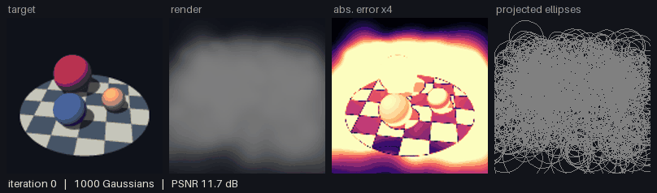
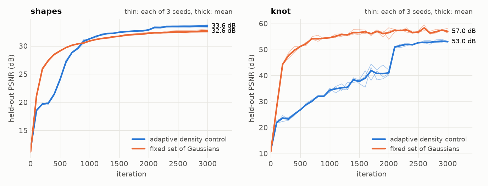
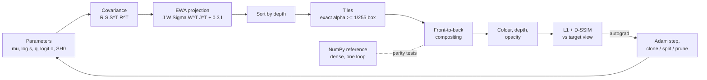

# microsplat

**3D Gaussian Splatting small enough to read in one sitting: a NumPy reference rasteriser, a differentiable PyTorch twin, and tests that pin every equation.**

[](https://github.com/guilhem0908/microsplat/actions/workflows/ci.yml)

[Results](#results) - [Quickstart](#quickstart) - [How it works](#how-it-works) - [Limitations](#limitations)



## Why this exists

During my 2026 research internship at AIST (Tsukuba, Japan) I worked on producing 360-degree navigation data from 3D Gaussian Splatting scenes. All of it went through existing renderers: 3DGRUT, Splatfacto and DISCOVERSE. This repository answers the question that work leaves open, namely what is inside the renderer: I rewrote the forward pass from the two papers, made it differentiable, and wrote a test for each equation instead of trusting the pictures. It is a personal side project, written with AI assistance (the commit trailers say so) and kept at a deliberately small scale; it does not replace the tools above.

## Results

<!-- begin:verdict -->
**Starting from random Gaussians, 3,000 iterations reach 33.6 dB PSNR on held-out views of the ray-traced `shapes` scene and 53.0 dB on the `knot` scene (mean of 3 seeds). Compared with a fixed set of 3,000 Gaussians, density control changes the PSNR by +0.9 dB on `shapes` and by -3.9 dB on `knot`.**
<!-- end:verdict -->
<!-- begin:setup -->
Setup: 128 x 128 images, 24 training views and 8 held-out views per scene, 3,000 iterations, 3 seeds per row (mean ± sample standard deviation), 4 CPU threads per run. The 12 runs, 4 at a time, took 23 minutes in total. Depth error: median of |z - z_true| / z_true over the pixels counted in the last column, pooled over the held-out views.
<!-- end:setup -->
<!-- begin:fit_table -->
| Scene | Density control | Final Gaussians | PSNR (dB) | SSIM | Median depth error | Depth pixels |
|:--|:--|--:|--:|--:|--:|--:|
| `shapes` | adaptive (clone / split / prune) | 2,088 ± 60 | 33.55 ± 0.21 | 0.9807 ± 0.0009 | 1.22 % | 44,392 |
| `shapes` | none (fixed set) | 3,000 ± 0 | 32.64 ± 0.21 | 0.9795 ± 0.0010 | 1.17 % | 44,252 |
| `knot` | adaptive (clone / split / prune) | 766 ± 9 | 53.04 ± 0.26 | 0.9998 ± 0.0000 | 0.12 % | 18,544 |
| `knot` | none (fixed set) | 3,000 ± 0 | 56.99 ± 1.03 | 0.9999 ± 0.0000 | 0.02 % | 18,542 |
<!-- end:fit_table -->



<!-- begin:reading -->
**How to read the table.**
- `shapes`: density control gains 0.91 dB with 2,088 Gaussians instead of 3,000. The depth metric ranks the two variants the other way round, narrowly (median error 1.17 % for the fixed set against 1.22 %, seed standard deviation 0.02 %): image quality and depth accuracy are different measurements.
- `knot` is exactly representable, by the 160 Gaussians that generated it, and there the fixed set wins by 3.9 dB. The adaptive curve stays far below until iteration 2,000, the last densification round, and climbs steeply right after it. I did not isolate the cause; one reading is that the clone / split rounds keep disturbing a scene that does not need more Gaussians. The comparison holds for this schedule (3,000 iterations, one hand-set gradient threshold), not in general.
<!-- end:reading -->

**Do the equations hold?** Each row is asserted by the test suite and re-measured by `scripts/reproduce.py`.

<!-- begin:verification_table -->
| Check | Measured | Bound in the tests |
|:--|--:|--:|
| Projection Jacobian vs central differences, max relative error | 1.2e-10 | < 1.0e-8 |
| EWA covariance vs Monte-Carlo (1,000,000 samples), Gaussian of 0.6 % of the viewing distance | 0.22 % | < 1 % |
| Same, Gaussian of 18 % of the viewing distance | 11.1 % | grows, by design |
| NumPy vs PyTorch float64, max abs. colour difference (5 scenes of 1,000 Gaussians) | 1.6e-15 | < 1.0e-10 |
| NumPy vs PyTorch float32, the 3 scenes sorted as in float64 | 6.9e-7 | < 1.0e-5 |
| NumPy vs PyTorch float32, all 5 scenes (2 with a depth tie) | 3.0e-4 | explained, not bounded |
| Autograd vs central differences, 5 parameter groups, 3 scenes, max relative error | 8.6e-9 | < 1.0e-6 |
<!-- end:verification_table -->

The float32 row that misses 1e-5 is not rounding noise: two centres closer in depth than float32 resolves are sorted the other way round, which changes the colour of the pixels they share and leaves the accumulated opacity untouched. A test asserts exactly that signature.

**What does it cost?**

<!-- begin:timing_table -->
| Scene state | Gaussians | NumPy reference render | PyTorch CPU render | PyTorch CPU step | PyTorch CUDA step |
|:--|--:|--:|--:|--:|--:|
| fitted | 2,051 | 1,488 ms | 19 ms | 51 ms | 33 ms |
| initial | 1,000 | 614 ms | 14 ms | 46 ms | 37 ms |

Median of 40 measurements at 128 x 128. A step is render + loss + backward + Adam update. Intel(R) Core(TM) i9-14900HX, 8 threads; NVIDIA GeForce RTX 4080 Laptop GPU; PyTorch 2.11.0+cu128. The NumPy reference is the specification, not a fast renderer: it takes 78 times longer than the PyTorch render on the fitted scene. The GPU is a laptop part that was not reserved for the measurement, so read the CUDA column as indicative.
<!-- end:timing_table -->

Raw data is in [`results/`](results). `scripts/check_readme.py` fails if a number in this section differs from those files.

## How it works



Each Gaussian has a centre $\mu$, a covariance $\Sigma = R S S^\top R^\top$ built from a quaternion and three log-scales, an opacity $o$ and a colour $c$. For a camera with rotation $W$ and a centre at camera coordinates $t$, its footprint on the image is the Gaussian of covariance

```math
\Sigma' = J W \Sigma W^\top J^\top + 0.3\,I, \qquad
J = \begin{pmatrix} f_x/t_z & 0 & -f_x t_x/t_z^2 \\ 0 & f_y/t_z & -f_y t_y/t_z^2 \end{pmatrix},
```

where $J$ is the Jacobian of the pinhole projection: the projection is linearised around the centre so that the footprint stays Gaussian. Pixels are then composited front to back:

```math
C(x) = \sum_i c_i\,\alpha_i\,T_i + T_{\text{end}}\,c_{\text{bg}}, \quad
\alpha_i = \min\big(0.99,\ o_i\,e^{-\frac12 d_i^\top \Sigma_i'^{-1} d_i}\big), \quad
T_i = \prod_{j<i}(1-\alpha_j), \quad d_i = x - \mu_i' .
```

`reference.py` evaluates this with one loop over the sorted Gaussians and no culling. `torch_renderer.py` evaluates the same expressions per 16 x 16 tile, keeping for each tile only the Gaussians whose alpha can reach 1/255 inside it. That bound is exact ($d^\top \Sigma'^{-1} d \le 2\ln(255\,o)$), so both renderers must agree to rounding, and `torch.autograd` supplies the gradients for the fitting loop. Derivations and the reasons for each choice are in [`docs/design.md`](docs/design.md).

## Quickstart

Linux / macOS, Python 3.12 or newer:

```bash
git clone https://github.com/guilhem0908/microsplat.git && cd microsplat
python -m venv .venv && source .venv/bin/activate
pip install torch --index-url https://download.pytorch.org/whl/cpu   # the CPU build is enough
pip install -e ".[dev]"
pytest -m "not slow and not gpu"       # equations, parity, gradients, short fits
python scripts/reproduce.py --quick    # small end-to-end run, writes out/quick/
python scripts/check_readme.py         # README numbers == results/
```

Windows PowerShell:

```powershell
git clone https://github.com/guilhem0908/microsplat.git; cd microsplat
python -m venv .venv; .\.venv\Scripts\Activate.ps1
pip install torch --index-url https://download.pytorch.org/whl/cpu
pip install -e ".[dev]"
pytest -m "not slow and not gpu"
python scripts/reproduce.py --quick
python scripts/check_readme.py
```

`python scripts/reproduce.py --jobs 4` reruns the full study and rewrites `results/` and `docs/`. A fitted scene is included as `results/shapes_adaptive_seed0.ply` in the INRIA layout; `microsplat.ply.load_ply` reads it back.

## Repository layout

```text
src/microsplat/
  reference.py        NumPy rasteriser, the specification: projection, sort, compositing
  torch_renderer.py   differentiable tile-based twin
  camera.py           pinhole model, look-at, orbit rings
  gaussians.py        scene container, activations, random initialisation
  scenes.py           ray-traced `shapes` scene and hidden-Gaussian `knot` scene
  fit.py, optim.py    optimisation loop and held-out evaluation; Adam with resizable state
  density.py          clone / split / prune
  metrics.py          PSNR, SSIM, L1 + D-SSIM loss
  ply.py              INRIA .ply export and import
  verify.py           the cross-checks, returning the errors they measure
  viz.py, settings.py ellipse overlay, GIF frames, PSNR plot; constants of the compositing equation
tests/                one file per module
scripts/              reproduce.py (results and figures), check_readme.py
docs/design.md        derivations and design decisions
results/              committed raw results: json, csv, one .ply
```

## Limitations

- **Synthetic scenes only.** Two scenes, one ray-traced and one rendered from hidden Gaussians, with exact poses. No photographs, no COLMAP, no view-dependent colour (spherical harmonics stop at degree 0). The numbers say nothing about real captures.
- **Few seeds.** Spreads are sample standard deviations of three runs; a gap of a couple of them, like the depth-error gap on `shapes`, is suggestive at most.
- **One hand-set schedule.** The learning rates and the density-control threshold were set once for a run a tenth as long as the paper's, and not searched. The adaptive-versus-fixed result may move with them.
- **Not the reference implementation.** No opacity reset, no size-based pruning, no Mip-Splatting filter, no CUDA kernels: speed is that of PyTorch tensor operations, from one CPU (trust the ratios more than the milliseconds), and not comparable with the published rasteriser.
- **Order of splats.** Gaussians are sorted once per image by the depth of their centre, so overlapping ones can be blended in the wrong order for some rays, as in the original method.

## References

- B. Kerbl, G. Kopanas, T. Leimkühler, G. Drettakis, [3D Gaussian Splatting for Real-Time Radiance Field Rendering](https://arxiv.org/abs/2308.04079), ACM TOG 42(4), 2023.
- M. Zwicker, H. Pfister, J. van Baar, M. Gross, [EWA Splatting](https://doi.org/10.1109/TVCG.2002.1021576), IEEE TVCG 8(3), 2002.
- Z. Wang, A. Bovik, H. Sheikh, E. Simoncelli, [Image Quality Assessment: From Error Visibility to Structural Similarity](https://doi.org/10.1109/TIP.2003.819861), IEEE TIP 13(4), 2004.
- D. Kingma, J. Ba, [Adam: A Method for Stochastic Optimization](https://arxiv.org/abs/1412.6980), ICLR 2015.
- Z. Yu, A. Chen, B. Huang, T. Sattler, A. Geiger, [Mip-Splatting: Alias-free 3D Gaussian Splatting](https://arxiv.org/abs/2311.16493), CVPR 2024.
- Tools: [PyTorch](https://pytorch.org), [NumPy](https://numpy.org), [Pillow](https://python-pillow.org), [Matplotlib](https://matplotlib.org), [pytest](https://pytest.org), [Ruff](https://docs.astral.sh/ruff/).

---

Guilhem Carmouze - robotics engineering student, UPSSITECH (University of Toulouse) - LinkedIn https://www.linkedin.com/in/guilhem-carmouze/ - https://guilhem0908.github.io
